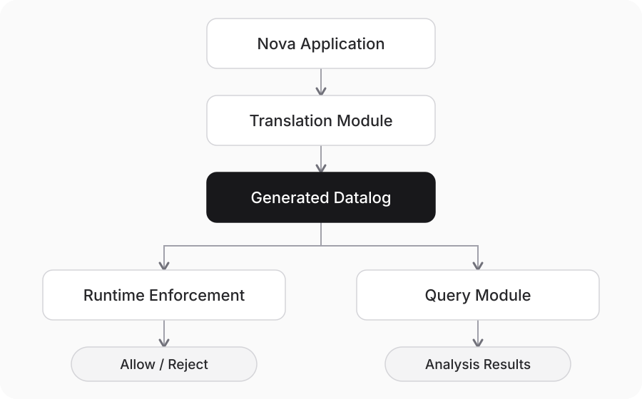

# Nova demo: from policy to execution and explanation

**Specification → Translation → Runtime Enforcement → Query & Analysis**



We describe an application and its policies, translate the application-specific requirements into Datalog, and use rules to check deliveries and answer questions. The system supplies shared rules and a message protocol.

The demo compares saved model output with handwritten **Reference** rules. Live enforcement and queries use Reference.

## 1. The Nova application

Nova is a confidential budget review. Board assigns work to three departments: Procurement, Facility and HR. Two auditors divide the review.

| | Procurement | Facility | HR |
| --- | --- | --- | --- |
| Auditor A may review | Yes | Yes | Yes |
| Auditor B may review | Yes | Yes | No |

**Neither auditor may collect all three departments' confidential information.** Each may receive at most two distinct parts. Successful delivery to an auditor counts as covering that part.

Start with A having received Procurement:

| Next assignment | What happens next? |
| --- | --- |
| Facility → A | A now has two parts. HR cannot go to A because it would be the third, or to B because B lacks HR permission. The audit cannot finish. |
| Facility → B | HR can go to A. A covers Procurement + HR, B covers Facility, and the audit finishes. |

An allowed assignment can leave no way to finish. Sending another copy to B cannot make A forget Facility; the earlier assignment must change.

Nova uses scripted agents with fixed permissions. The model translates policies.

## 2. Shared rules and protocol

Open **Rules → Runtime**. Datalog defines what follows from the available facts. The protocol defines where those facts live, what a message carries, and when a decision takes effect.

### Input facts (EDB): who supplies them?

EDB facts are inputs. Rules derive further facts. Below, `P` is a principal, `M` a message, and `T` an information tag.

| Input predicates | Meaning and source |
| --- | --- |
| `Sender(P, M)`, `Incoming(P, M)` | Runtime: sender and pending recipient. |
| `Received(P, M)` | Runtime: successful delivery, recorded only after approval. |
| `ReceivedBeforeSend(M1, M2)` | Runtime: the sender received M1 before sending M2. |
| `TrustedSource(M, T)` | Trusted ingestion: Board assigns the original tags. Ordinary message text cannot change them. |
| `TransportTag(M, T)` | Transport: tags computed at the sender, not freely declared by its agent. |
| `HasCap(P, C)`, `Requires(T, C)`, `TagGroup(T, G)` | Trusted app configuration: permissions, requirements and groups. The model cannot grant permissions. |
| `Auditor(P)`, `AuditGoal(G, T1, T2, T3)` | Nova configuration: reviewers and the parts to cover. |

### Derived facts (IDB): the core ideas

| Derived predicate | Meaning |
| --- | --- |
| `MessageTag(M, T)` | M carries information T, including inherited tags. |
| `MayDependOn(M2, M1)` | M2 may use M1. Tracks possible dependence, not proven use. |
| `HasReceivedTag(P, T)` | P has successfully received information tagged T. |
| `Deny(M, message_policy)` | Refuse delivery to P; shared or app rules can derive this. |
| `Covered(T)`, `Finished(G)` | Nova's review coverage and completion result. |

Three shared rules illustrate the foundation:

```prolog
MessageTag(M, T) :- TransportTag(M, T).

HasReceivedTag(P, T) :- Received(P, M), MessageTag(M, T).

Deny(M, message_policy) :- Incoming(P, M), MessageTag(M, T),
                     Requires(T, C), not HasCap(P, C).
```

The remaining shared rules track possible dependencies and propagate tags. Rewriting a message does not remove its tracked information.

### Optional: Datalog vs. protocol

**Datalog defines what can be inferred. The protocol defines where facts are stored, where inference runs, and how facts are exchanged.**

The motivation is:

- **Scalability:** use local state for local checks, reducing the need to copy and process the entire global state at every agent.
- **Privacy:** exchange the information needed for a check, without exposing unrelated agents' histories.

The goal is to preserve the same inference results and delivery decisions as the full-copy baseline.

### What changes in `message_send`?

Instead of delivering directly, the send/receive path becomes:

```text
message_send → compute and attach tags → check at recipient → deliver or refuse
```

Another framework needs an adapter around its message delivery path: bind trusted sender/recipient identities, supply initial tags and permission configuration, and run the receive check **before the body reaches the agent's context**. Successful delivery then updates that recipient's history. Nova implements these hooks today; automatic integration with arbitrary frameworks is not yet provided.

## 3. Translating P3

In **Rules → Nova input**, the translator reads the app, policy, tools and agent descriptions. It also receives the shared rules, vocabulary, trusted configuration and fixed protocol. It does not receive episodes, reference app rules or test cases.

**One model call, without tools, generates application rules.** The protocol is supplied, not generated.

P3 describes the information limit:

> Except for Board, no agent may receive a message that would expose three distinct confidential parts from the same project group, combining incoming information with information already received. Repeated parts count once; unrelated groups do not combine.

One reference rule handles two previously received parts plus one incoming part:

```prolog
Deny(M, message_policy) :-
    Incoming(P, M),
    HasReceivedTag(P, T1), HasReceivedTag(P, T2), MessageTag(M, T3),
    TagGroup(T1, G), TagGroup(T2, G), TagGroup(T3, G),
    P != "board", T1 != T2, T1 != T3, T2 != T3.
```

Two more rules handle messages carrying two or all three parts.

Click **View historical translation**, select **P3**, and show **Reference (historical)** beside **Generated**:

| Reference | Saved model output |
| --- | --- |
| Three rules cover the three incoming/history combinations. | Covers those combinations and adds a fourth rule for a recipient already holding all three parts. |
| Tests distinct tags, a shared group, and the Board exception. | Includes those same checks. |

The extra rule can change behavior in an already-invalid starting state, though it does not affect the normal example. Compare behavior, not just rule text.

The saved output uses the earlier names `Propagated` and `Knows` for `MessageTag` and `HasReceivedTag`.

## 4. Runtime enforcement

1. Open **Rules → Reference → Start reference session**. Close the dialog.
2. Click **Before second delivery**. A already has Procurement.
3. Click **Next event** twice: send Facility, then deliver it. This is allowed.
4. Click **Next event** twice again: send HR, then check delivery. This is refused.

A has HR permission, but the combination limit still blocks delivery. **Rules → Prevention** checks decisions, receipts and whether recipients can read the content.

## 5. Queries and planning

Click **Before third delivery** first. HR message `mH` is pending; A has received Procurement (`mP`) and Facility (`mF`). Leave the snapshot on **Current runtime**.

In **Questions**, select a question and click **Open example**. This fills the query and selects its scope.

Start with a fact lookup, then follow four analysis questions: **Why was it blocked? What if one earlier delivery had not happened? Which deliveries would we need to prevent? How could the audit still finish?**

| Question | Category → template | Exact input | Scope and result |
| --- | --- | --- | --- |
| What permission does A have? | Capability → `HasCap({principal}, Cap)` | Query: `?- HasCap(auditor_a, Cap).` | A; `hr_review`. |
| Why can't B receive HR? | Capability → `Requires({tag}, Cap), not HasCap({principal}, Cap)` | Query: `?- Requires(nova_hiring, Cap), not HasCap(auditor_b, Cap).` | B; missing `hr_review`. |
| Who has received HR information so far? | Information flow → `HasReceivedTag(P, {tag})` | Query: `?- HasReceivedTag(P, nova_hiring).` | Global debug view; `hr`, not A or B. |
| Why would A's pending HR delivery be refused? | Communication → `WHY Deny({message}, message_policy)` | Why / FACT: `Deny(mH, message_policy)` | A; proof combines two previously received tags with the incoming HR tag. |
| Would it still be refused without the earlier Facility receipt? | Communication → What-if | FACT: `Deny(mH, message_policy)`; REMOVE: `Received(auditor_a, mF).`; ADD: empty | Result: false. This changes a hypothetical input state, not the live history. |
| What is the smallest set of earlier deliveries to avoid so A can receive HR? | Communication → Min-prevention | FACT: `Deny(mH, message_policy)`; use the two candidate receipt events: Procurement → A and Facility → A. | Two alternatives: prevent the Procurement receipt alone or the Facility receipt alone. Each removes the block; neither result by itself is a complete audit plan. |

**Query** uses `?-` and a final period; **Why** takes a single fact. The global scope is **Debug · reconstruct all local stores**.

**What-if tests a change we specify. Min-prevention searches for the fewest events to avoid, within the supplied event list.** Both are hypothetical analyses; neither makes an agent forget information it has already received.

### Finish by finding a better assignment

Open **Planning** in the analysis terminal:

| Field | Value |
| --- | --- |
| Starting state | **Before second delivery · A has Procurement** |
| GOAL | `Finished(nova)` |
| PROGRESS ACTIONS | Keep the default six department-to-auditor routes. |

Run the search. Expand `facility->auditor_a`: it is allowed but **dead-ending**. Expand `facility->auditor_b`: it preserves completion, followed by `hr->auditor_a`.

The search explores Nova's configured routes using the same rules. **Replay completion in runtime** replaces the live session with the chosen starting state and executes a successful trace.

After replaying a successful trace, use the global scope and run:

```prolog
?- Finished(Group).
```

The result is `nova`. Before the successful split, it returns no rows.

## 6. From natural-language questions to queries

Choose **Before third delivery**, then open **Questions**. The four suggestion buttons fill the question box; **Interpret question** calls the configured model.

| Suggestion | Question | Arguments shown in the terminal |
| --- | --- | --- |
| Why | Why would A's pending HR message be blocked? | FACT and recipient scope |
| What-if | If A had not received Facility, would HR still be blocked? | FACT; REMOVE = A's Facility receipt; ADD = none |
| Min-prevention | Among A's Procurement and Facility deliveries, what is the smallest set to prevent so HR is not blocked? | FACT and the two candidate receipt events |
| Planning | From when A had only Procurement, can Facility and HR be assigned to either auditor to finish Nova? | GOAL; starting state; four allowed routes |

The model selects a supported template and fills entity IDs, candidate messages or routes. Code validates those choices and constructs the executable arguments. **Interpreted arguments** shows the bindings; the form below shows the actual query, REMOVE/ADD, events or planning inputs. Click the analysis button to execute.

The What-if template currently removes one earlier receipt; ADD stays empty and is explicitly labeled. Min-prevention searches only the supplied receipt events. Planning searches only the selected routes. None changes the live application unless a successful plan is explicitly replayed.

**Open example** loads a deterministic example without a model. **Interpret question** always uses the configured model, even when the wording matches an example.

[Launch and model connection instructions](../apps/nova/README.md)
