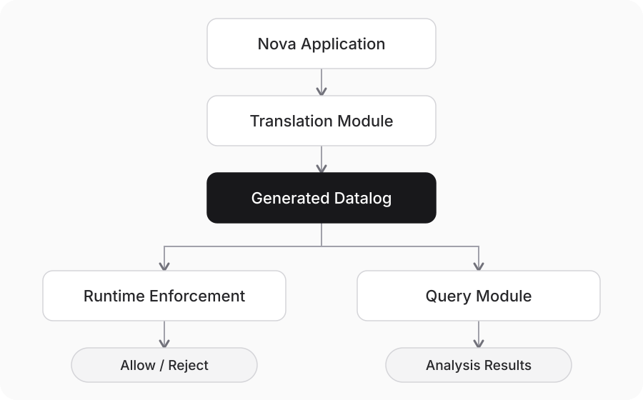

# Nova 组会演示（约 18 分钟）

**想讲清楚一件事：把应用的文字要求变成规则，用规则拦住违规操作，再解释为什么。**

全程围绕同一个例子：采购、设施和人事部门分别持有一份保密材料。审计员 A 可以接收其中任何一份，但不能把同一项目的三份都收齐。

## 整体流程



图中是整体流程。执行和查询共用系统的基础规则；生成规则需要先检查。本次现场执行使用人工参考规则，翻译结果单独展示和比较。

## 1. 开场：我们在做什么？（1 分钟）

可以这样说：

> 多个 agent 合作时，有些消息可以发，有些不能发。我们希望把这些要求写清楚，让系统在消息交付前检查，并能回答“为什么允许、为什么拒绝”。今天用 Nova 走一遍这个过程。

Nova 目前用脚本安排角色的行动；翻译规则这一步使用真实模型。

## 2. 基础规则：系统已经提供了什么？（3 分钟）

打开论文中的规则，或界面的 **Rules → Runtime**。只挑三件事讲：

- **权限**：接收某类信息，需要相应权限。
- **信息传递**：转发或改写消息，不能自动去掉原有的保密标签。
- **交付检查**：发送方带上标签，接收方先检查，允许后才交付内容。

一句话区分：这些是系统提供的基础；“同一个审计员不能收齐三份材料”是 Nova 自己的要求。

## 3. 翻译：Nova 的要求怎样变成规则？（5 分钟）

先打开 **Rules → Nova input**，展示应用说明、角色、工具和政策。重点读 P3：普通审计员不能收到同一项目的第三份不同材料。

说明三类内容的来源：

| 内容 | 谁提供 |
| --- | --- |
| 基础规则和消息处理方式 | 系统 |
| 有哪些角色、谁有什么权限、材料如何分组 | 应用配置；模型不能自行授予权限 |
| Nova 特有的限制和审计要求 | 模型根据文字要求生成，人工规则用于对照 |

点击主页 **View historical translation**，查看保存好的真实模型输出及当时的对照结果（历史协议）。它不会重新调用模型，也不会更换当前运行的规则。

页面上方是自然语言原文，下面左边是 **Reference（当时的人工规则）**，右边是 **Generated（模型规则）**。用 **Policy** 选择 P1–P5，现场重点展示 P3。

| 文字要求 | 对应实现 | 本次模型输出 |
| --- | --- | --- |
| P1：转发、改写不能去掉保密保护 | 系统的标签传播规则和发送流程 | 复用系统规则 |
| P2：接收信息需要相应权限 | 系统的权限检查，加上应用配置 | 复用系统规则 |
| P3：普通审计员不能收齐同组的三份材料 | Nova 的三种组合检查 | 生成了四条规则，比人工版多检查一种情况 |
| P4：拒收后不能读到内容，也不能因此获得信息 | 接收流程，以及只记录成功接收的规则 | 复用系统规则和接收流程 |
| P5：不同审计员可以共同完成审计 | 当时的审计记录与完成规则 | 属于旧协议，详细比较留在实验记录 |

> 比较的是它们在相同情况下会得出什么结果，不是代码长得像不像。

**比较时只讲一个例子：** P3 的模型版比人工版多了一种检查。先看同一个消息是否会被允许，再讨论规则表达的区别，不需要现场展开所有边界情况。

保存的翻译属于旧协议，不能直接安装到当前运行时；历史差异和检查结果见[实验记录](translation-model-comparison.md)，不放进这次 demo 主线。

现场优先用 replay，避免等待模型。重新生成仍通过命令行运行；页面按钮不会伪装成一次新翻译。

## 4. 执行：先允许一次，再拒绝一次（4 分钟）

**先说明：接下来现场运行使用 Reference，也就是人工参考规则。**

1. 在 **Reference** 中点 **Start reference session**，关闭窗口，再点 **Before second delivery**。这时 A 已经收到采购材料。
2. 点一次 **Next event**，发送设施材料；再点一次，完成接收。这是合法操作。
3. 再点一次 **Next event**，发送招聘材料；再点一次，触发检查。这次被拒绝，因为 A 会收齐三份材料。

| 操作 | 结果 |
| --- | --- |
| 接收第二份材料 | 允许，实际交付 |
| 接收第三份材料 | 拒绝，不进入接收者可读取的内容 |

强调：A 有查看招聘信息的权限，但“有权限”并不代表可以违反三份材料的组合限制。

页面是演示者视角，能查看被拦截的尝试；这不代表接收方已经看到了内容。需要证据时，打开 **Rules → Prevention**，查看交付和内容可见性的检查结果。

## 5. 查询：系统能解释什么？（4 分钟）

先点 **Before third delivery**，回到第三条消息还在等待检查的时刻。打开 **Questions**，用已有模板展示下面三个问题。

| 想问什么 | 展示什么 |
| --- | --- |
| A 有什么权限？ | A 有查看招聘信息的权限 |
| 谁已经收到招聘信息？ | 人事部门已收到，A 尚未收到 |
| 为什么这条消息会被拦住？ | A 已有两份材料，加上这条就会凑齐三份 |

每次都按同一个顺序：**选问题 → 看自动填好的查询 → 运行 → 解释结果**。保留模板自动选择的角色和查询范围。

这样，前面的文字政策、生成规则、实际拒收和拒收原因，就连成了同一个故事。

## 6. 收尾：希望得到什么反馈？（1 分钟）

> 我们已经把应用说明、规则翻译、执行检查和查询解释接了起来。现在展示的是一个可运行的例子，还不是全面的正确性评测。
>
> 接下来最想确认的是：这些规则能否表达更多真实应用的要求？翻译结果该怎样检查？用户最需要哪些查询？

## 演示前准备

- 提前打开 Nova、论文和真实翻译输出，完整走一遍上面的点击顺序。
- 确认页面显示 **Reference**；不要把本次未通过检查的模型输出说成正在执行的规则。
- 备好输出和截图。启动方式、翻译命令见 [Nova 使用说明](../apps/nova/README.md)。

## 怎么打开页面

在仓库根目录运行：

```bash
./apps/nova/run.sh         # 启动或重启，保留演示状态
./apps/nova/run.sh status  # 检查是否正常
./apps/nova/run.sh stop    # 停止
```

浏览器打开 <http://127.0.0.1:5180/>。如果用 VS Code 远程连接，先在 **Ports** 面板转发 **5180**。首次使用、还没有镜像时，启动命令会自动构建；需要更新镜像可先运行 `./apps/nova/run.sh setup`。

主页 **View historical translation** 进入并排对比；**Rules → Runtime** 展示系统自带的规则与协议；**Rules → Reference** 展示 Nova 自己的规则与协议；**Questions** 打开查询模板。

## 三个容易混淆的设计点（问到再讲）

- **TransportTag 和 MessageTag**：前者是消息带来的标签输入，后者是本地推导出的标签，包括可信源、收到的标签和依赖传播。发送方只传这条消息的标签，不传整套推导历史；接收方用 `MessageTag(M, T) :- TransportTag(M, T).` 接上本地计算。检查时有标签不代表已经读到正文；允许后才记录成功接收。分开命名是为了区分输入与推导结果，并非唯一实现方式。
- **Covered 与完成状态**：审计员在本地根据成功收到的材料推导 `Covered(Tag)`，不传给 Board，也不持久化为收据。全局查询汇总各地的推导结果后计算 `Finished(Group)`；本地 gate 不计算 Finished，也不能依赖它。本次演示固定使用审计员 A 和 B，不涉及身份变更。
- **Finished 为什么带 Group**：当前实现按组配置审计目标，参数说明“哪一组完成了”。如果一个运行实例只承载一个审计任务，概念上可以简化为 `Finished()`。多任务时应保留任务 ID；信息分组和任务不必永远是同一个概念。本次保留现有签名，以便原样比较保存的翻译结果。
