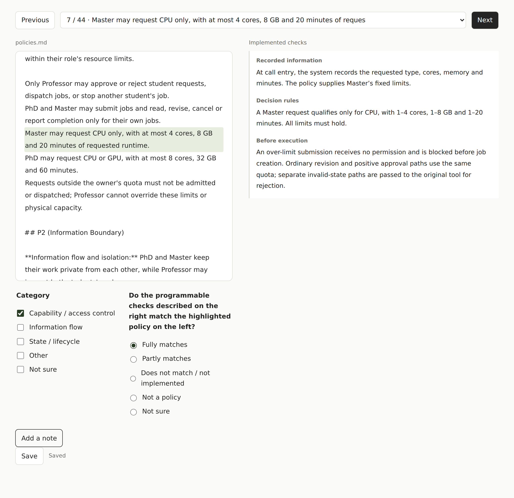
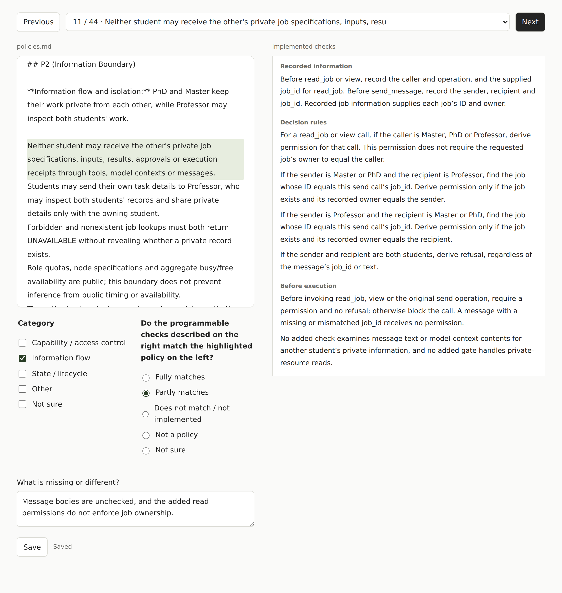

# Phase 2: Translate, Review, Test

In Phase 1, you built an app and described its policies. In Phase 2, we want to understand whether automated policy translation preserves your intent, and how your original app follows or violates its policies during real runs.

Complete Tasks 1–3 below and submit your results on a branch named `phase2`. Details for Task 4 will follow. Our tool will generate a version of your app with executable policy enforcement. You do not need to inspect the generated implementation or understand how the tool works internally.

## 1. Translate

Create a Git branch named `phase2` for your submission. Prepare a clean clone of your original app, with `app.md` and `policy.md` in the repository root.

Follow Appendix A to install the tool and set the directory and model variables. Then run:

```bash
python "$XX_DIR/translate.py" "$BASE_APP_DIR" "$TRANSLATED_APP_DIR"
```

The script reads your policy and app code, and writes the modified app to `TRANSLATED_APP_DIR`. Your original app stays unchanged. The script also translates the implemented policy back into English and aligns the descriptions with the original text in `policy.md`. These results are saved in `TRANSLATED_APP_DIR/back-translation/`.

## 2. Review

We want to study whether the translated policy matches your intent as the app creator. You do not need to inspect the modified app. Instead, compare your original policy with the English descriptions generated from its implemented enforcement.

You may use our review panel. It shows each original sentence on the left and the corresponding implemented checks on the right. The descriptions explain what is checked, when it is checked, and where the information comes from. One sentence may correspond to several checks.

```bash
python "$XX_DIR/review.py" \
  --back-translation "$TRANSLATED_APP_DIR/back-translation" \
  --policy "$BASE_APP_DIR/policy.md"
```

For each sentence, select:

- **Fully matches**
- **Partly matches**: describe what is missing or different.
- **Does not match / not implemented**: describe the difference.
- **Not a policy**
- **Not sure**: for example, the execution description is unclear.

See Appendix C for screenshots and examples of full and partial matches. The example ratings are human judgments; the tool does not assign your ratings.

Also classify each policy. You may select multiple categories:

- **Capability / access control**: who may perform which operations.
- **Information flow**: what information may go where, and who may access it.
- **State / lifecycle**: operation ordering, required states, and lifecycle constraints.
- **Other**: enter your own category.

Click **Save** to write your judgments to `TRANSLATED_APP_DIR/review.json`. The panel creates the file if needed and loads an existing file so you can resume unfinished work. You may also fill in the generated `review.json` directly without using the panel; see Appendix B.

## 3. Test

We want to understand which policies arise during real runs, and whether your app follows or violates them. Construct **5–10 test scenarios**, covering normal use, possible violations, and boundary cases. Run them on your **original app**, keeping its existing protections. You do not need to add new guards.

Run each scenario and record the following in `test_cases.json`:

- `task`: a description that helps us understand the scenario.
- `violated_policies`: policies violated in the recorded run, with brief observations and the source of each judgment.
- `followed_policies`: relevant policies followed in the recorded run, with brief observations and the source of each judgment.
- `run_command`: the command for rerunning the scenario.
- `trajectory_file`: the relative path to your example run's JSONL trajectory.

For example:

```json
{
  "cases": [
    {
      "task": "Transfer $100 to a new recipient, then attempt a transfer above the daily limit.",
      "violated_policies": [
        ["P1: The first transfer was executed without user confirmation.", "human-judge"]
      ],
      "followed_policies": [
        ["P3: The second transfer was rejected for exceeding the daily limit.", "human-judge"]
      ],
      "run_command": "python tests/run_transfer_scenario.py",
      "trajectory_file": "traces/transfer_scenario.jsonl"
    }
  ]
}
```

In this example, the first entry identifies P1 as violated because the trajectory shows a transfer without user confirmation. Both policy lists describe your observed run. They may be empty; omit policies that were not involved.

Each entry in either list is a pair: `[observation, judge]`. In JSON, write it as a two-element array. Use `human-judge` for a human judgment, `llm-judge` for an LLM judgment, or `both` when both contributed.

You may use policy IDs such as P1 or describe the policy in words. If needed, edit `policy.md` to split P2 into P2.1, P2.2, and so on, with each policy on a separate line. Make these edits before translation.

Use JSONL for the trajectory; we do not require a fixed event schema. Preserve event order and include user inputs, agent interaction messages, visible LLM outputs, tool-call arguments, and tool results. Hidden reasoning is not required.

In your README, explain the original app's environment, how to run each test, and how to read its trajectory. Include the required scripts, inputs, and initial data. Document any manual inputs or actions. Rerunning a test does not need to produce an identical trajectory.

For Tasks 1–3, copy the generated directory, including your completed `review.json`, into `translated-app/` on your `phase2` branch. Submit:

- `translated-app/`: the modified app from Task 1, including `back-translation/` and `review.json` from Task 2.
- `test_cases.json`, test scripts, inputs, initial data, and trajectories from Task 3.
- A README explaining how to run your original app and each test, with the original app's commit recorded.

## 4. Further tasks (details to follow)

Details will be released on **Tuesday, November 17, 2026**. Planned tasks include running each scenario five times on the translated app to examine whether policy violations are intercepted, and using our trajectory QA tool to compare its analysis with manual inspection or Codex-assisted reading. The procedure and reporting requirements will be announced then.

## Appendix A. Environment and model setup

The current runner uses Linux x86_64, Python 3.10+, Docker, and the Linux Codex CLI. From the tool repository, install the Python packages and build the execution images once:

```bash
cd translation
python -m pip install -r requirements.txt
cd ..
docker build -f evaluation/porting/Dockerfile -t policy-portin:local .
docker build -f evaluation/porting/Dockerfile.batch -t policy-portin:batch-v1 .
```

Set the tool directory, the clean original app directory, and an empty or nonexistent output directory:

```bash
export XX_DIR="/path/to/tool-repo/translation"
export BASE_APP_DIR="/path/to/original-app"
export TRANSLATED_APP_DIR="/path/to/translated-app"
```

Set your API key. The model and reasoning effort default to the values shown:

```bash
export POLICY_API_KEY="YOUR_API_KEY"
export POLICY_MODEL_ID="gpt-6.1-sol"
export POLICY_REASONING_EFFORT="medium"
```

Keep your API key out of the repository. For a compatible API endpoint, you may also set `POLICY_BASE_URL`. With the default model, budget approximately US$2–5 per app for translation and back-translation, based on our current examples; costs depend on app size and retries.

## Appendix B. Editing review.json directly

Use the file generated by the tool. Keep its version identifiers, sentence IDs, and original text unchanged. Fill in these fields for each sentence:

| Field | Values |
| --- | --- |
| `rating` | `fully_correct`, `partially_correct`, `not_covered`, `not_policy`, or `unsure`; leave empty if unfinished. |
| `categories` | A list containing `permission`, `information_flow`, `lifecycle`, `other`, or `uncertain`. |
| `note` | Your observation; required for `partially_correct` and `not_covered`. |
| `other_category` | Your category name when selecting `other`. |

Use `uncertain` alone when you cannot classify a policy. Leave categories empty for `not_policy`. The panel can load your edited file when it starts. If you change `policy.md` or regenerate the translation, use the corresponding new review file.

## Appendix C. Review examples

These screenshots illustrate the review format with a human-authored back-translation of LabCluster's added policy layer. The selected ratings and comments are also human judgments.

### 1. Fully matches: Master resource limits

**Original policy:** Master may request CPU only, with at most 4 cores, 8 GB and 20 minutes of requested runtime.

The added submission check reads the requested resources and uses Master's configured limits. A non-CPU or over-limit submission receives no permission and is blocked before job creation. For this requirement, select **Fully matches** and **Capability / access control**.



### 2. Partly matches: private information can still leak in messages

**Original policy:** Neither student may receive the other's private job specifications, inputs, results, approvals or execution receipts through tools, model contexts or messages.

The added message-route checks compare the referenced job's owner with the sender or recipient, but they do not inspect message bodies. Professor can send Master a message referencing Master's own job while including PhD's private information in its text. The added read permissions also do not filter ownership. Select **Partly matches** and **Information flow**, and describe the missing protection.


